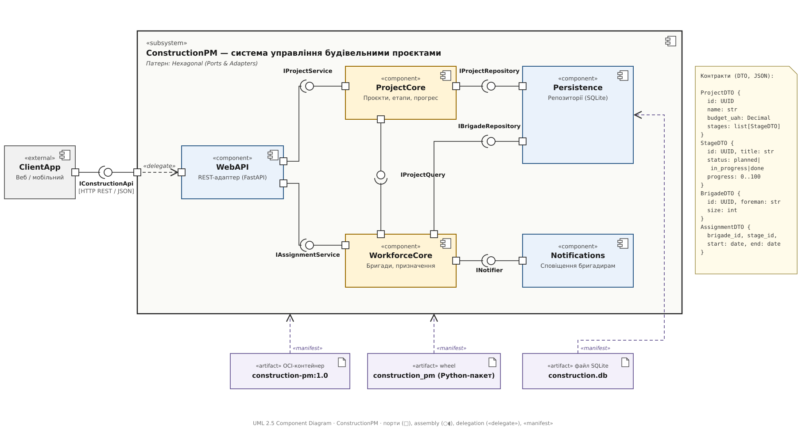

# Архітектура ConstructionPM

**ConstructionPM** — система управління будівельними проєктами. Вона веде облік об’єктів будівництва, етапів робіт і їх прогресу, а також призначає бригади на етапи й сповіщає бригадирів.

Модель: діаграма компонентів UML 2.5. Виконано в draw.io за специфікацією OMG UML 2.5.



Файли моделі:

| Файл | Призначення |
|---|---|
| `component_diagram.drawio` | Редагований вихідний файл draw.io (відкривається в draw.io / diagrams.net) |
| `component_diagram.svg` | Векторний експорт діаграми |

## 1. Реєстр компонентів

| Компонент | Шар | Призначення | Межі відповідальності | Нефункціональні характеристики (NFR) |
|---|---|---|---|---|
| **WebAPI** | Вхідний адаптер | REST-інтерфейс системи для веб- і мобільних клієнтів | Приймає HTTP-запити та валідує DTO. Перетворює DTO ↔ доменні моделі й мапить помилки на HTTP-коди. Бізнес-правил не містить | Відповідь ≤ 300 мс (p95) для читання. JSON UTF-8. Коди 2xx / 4xx / 5xx за RFC 9110 |
| **ProjectCore** | Домен | Проєкти, етапи робіт, бюджет, прогрес | Інваріанти проєкту: бюджет ≥ 0, прогрес 0..100, коректна послідовність статусів `planned → in_progress → done`. Не знає про HTTP і БД | 100% детермінований. Покриття тестами ≥ 75% (ПР3). Типізовані доменні помилки |
| **WorkforceCore** | Домен | Бригади та призначення їх на етапи | Перевіряє, що етап відкритий, бригада вільна в обраний період, а дати коректні. Ініціює сповіщення бригадира | Без перетину призначень однієї бригади. Ідемпотентне повторне призначення |
| **Persistence** | Вихідний адаптер | Збереження проєктів, бригад і призначень | Реалізує репозиторії поверх SQLite і транзакційно зберігає агрегати. Бізнес-логіки не містить | Цілісність даних (транзакції). Заміна СУБД без зміни домену |
| **Notifications** | Вихідний адаптер | Доставка повідомлень бригадирам | Формує повідомлення й надсилає їх каналом доставки (Telegram Bot API або журнал). Помилка доставки не зриває призначення | Тайм-аут доставки ≤ 5 с. Повторна спроба 3×. Помилка доставки повертається як результат, а не виняток |

`ClientApp` — зовнішній клієнт (веб-сторінка або застосунок на смартфоні виконроба). До складу системи він не входить.

## 2. Матриця інтерфейсів

Позначення: **P** — інтерфейс надання (provided, «lollipop»), **R** — інтерфейс споживання (required, «socket»).

| Інтерфейс | Надає (P) | Споживає (R) | Протокол | Операції (сигнатури) | Вхід / вихід |
|---|---|---|---|---|---|
| `IConstructionApi` | ConstructionPM (порт системи → delegate → WebAPI) | ClientApp | HTTP REST, JSON | `POST /projects`<br>`GET /projects/{id}`<br>`POST /projects/{id}/stages`<br>`PATCH /stages/{id}/progress`<br>`POST /assignments`<br>`GET /brigades/{id}/schedule` | `ProjectCreateDTO` → `201 ProjectDTO`<br>— → `200 ProjectDTO` / `404`<br>`StageCreateDTO` → `201 StageDTO`<br>`{progress:int}` → `200 StageDTO` / `422`<br>`AssignmentDTO` → `201` / `409` (бригада зайнята)<br>— → `200 list[AssignmentDTO]` |
| `IProjectService` | ProjectCore | WebAPI | Виклик у процесі (IPC) | `create_project(name: str, budget_uah: Decimal) -> Project`<br>`add_stage(project_id: UUID, title: str) -> Stage`<br>`update_progress(stage_id: UUID, percent: int) -> Stage`<br>`get_project(project_id: UUID) -> Project` | Доменні сутності `Project`, `Stage`. Помилки: `ValidationError`, `NotFound` |
| `IAssignmentService` | WorkforceCore | WebAPI | Виклик у процесі | `assign_brigade(brigade_id: UUID, stage_id: UUID, start: date, end: date) -> Assignment`<br>`brigade_schedule(brigade_id: UUID) -> list[Assignment]` | `Assignment`. Помилки: `BrigadeBusy`, `StageClosed`, `NotFound` |
| `IProjectQuery` | ProjectCore | WorkforceCore | Виклик у процесі | `get_stage(stage_id: UUID) -> StageView \| None`<br>`is_stage_open(stage_id: UUID) -> bool` | `StageView` — лише для читання |
| `IProjectRepository` | Persistence | ProjectCore | SQL (SQLite) | `save(project: Project) -> None`<br>`get(project_id: UUID) -> Project \| None`<br>`find_by_stage(stage_id: UUID) -> Project \| None` | Агрегат `Project` |
| `IBrigadeRepository` | Persistence | WorkforceCore | SQL (SQLite) | `get(brigade_id: UUID) -> Brigade \| None`<br>`save_assignment(a: Assignment) -> None`<br>`assignments_for(brigade_id: UUID) -> list[Assignment]` | `Brigade`, `Assignment` |
| `INotifier` | Notifications | WorkforceCore | Виклик у процесі → Telegram Bot API (HTTPS) | `notify(recipient: str, text: str) -> DeliveryResult` | `DeliveryResult{delivered: bool, error: str \| None}` |

### Моделі даних (DTO, серіалізація JSON)

```text
ProjectDTO    { id: UUID, name: str, budget_uah: Decimal, stages: list[StageDTO] }
StageDTO      { id: UUID, title: str, status: "planned"|"in_progress"|"done", progress: int (0..100) }
BrigadeDTO    { id: UUID, foreman: str, size: int }
AssignmentDTO { brigade_id: UUID, stage_id: UUID, start: date (ISO 8601), end: date (ISO 8601) }
```

DTO існують лише в адаптері WebAPI. Доменні компоненти працюють із власними сутностями (`Project`, `Stage`, `Brigade`, `Assignment`). Перетворення DTO ↔ сутність виконується на межі.

## 3. Порти, з’єднання та артефакти

- **Порти (□)** розміщені на межах кожного компонента. Через них проходять усі взаємодії, тож внутрішня будова компонента прихована.
- **Assembly-конектори (○◖)** з’єднують інтерфейс споживання одного компонента з інтерфейсом надання іншого. На діаграмі їх шість внутрішніх і один зовнішній (`IConstructionApi`).
- **Delegation-конектор («delegate»)** передає виклики від зовнішнього порту підсистеми ConstructionPM до порту WebAPI.
- **«manifest»:**
  - `construction-pm:1.0` — OCI/Docker-образ, у якому розгортається вся підсистема (ПР4);
  - `construction_pm` — Python-пакет (wheel) з кодом компонентів (ПР2);
  - `construction.db` — файл SQLite, що втілює дані компонента Persistence.

## 4. Обґрунтування декомпозиції

Обрано патерн **Hexagonal Architecture (Ports & Adapters)** з елементами **Clean Architecture**:

1. **Домен у центрі.** ProjectCore і WorkforceCore (виділені жовтим) містять усі бізнес-правила й не залежать ні від HTTP, ні від бази даних, ні від Telegram. Їхні залежності спрямовані назовні лише через абстрактні інтерфейси `I*Repository` та `INotifier`.
2. **Адаптери на краях.**
   - WebAPI — вхідний адаптер: «драйвер», що викликає домен.
   - Persistence і Notifications — вихідні адаптери: «керовані», їх викликає домен.

   Заміна SQLite на PostgreSQL чи Telegram на e-mail не змінює доменний код.
3. **High Cohesion.** Кожен доменний компонент відповідає за одну підобласть: «що будуємо» (проєкти, етапи) або «хто будує» (бригади, призначення).
4. **Low Coupling.** WorkforceCore звертається до ProjectCore лише через вузький інтерфейс читання `IProjectQuery` і не може змінити проєкт. Циклічних залежностей між компонентами немає.
5. **Тестованість.** Кожен інтерфейс споживання можна підмінити тестовим двійником (mock або in-memory репозиторій), що потрібно для ПР3.

Чому не інші патерни:
- **Layered:** допускає залежність домену від шару даних.
- **Event-Driven:** надмірний для однієї системи з синхронними сценаріями. Його можна додати пізніше для сповіщень.
