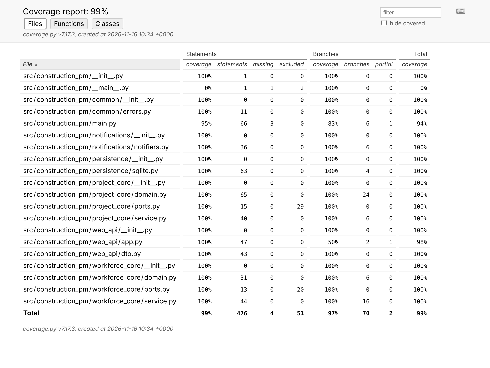

# QA-звіт: тестування ConstructionPM (ПР3)

## 1. Інструменти

| Призначення | Інструмент |
|---|---|
| Тестовий фреймворк | pytest 9.2 |
| Тестові двійники | `unittest.mock` (`create_autospec`, `MagicMock`, `patch`) + власні Fakes (`tests/fakes.py`) |
| Покриття коду | coverage.py через pytest-cov 7.1 (рядки + гілки), звіти HTML / XML / термінал |
| CI | GitHub Actions: лінтер → тести з порогами покриття → збірка → демо |

Запуск локально:

```bash
pip install -e ".[dev]"
pytest --cov --cov-report=term --cov-report=html     # звіт у htmlcov/index.html
coverage report --include="*/project_core/*,*/workforce_core/*" --fail-under=75
```

## 2. Структура тестів

Тести дзеркально повторюють структуру пакетів `src/construction_pm/`:

| Каталог | Рівень | Що перевіряється | Тестові двійники |
|---|---|---|---|
| `tests/project_core/` | Unit | Інваріанти `Project` і `Stage`, перехід статусів, `ProjectService`, `IProjectQuery` | Fake `InMemoryProjectRepository`, Mock `IProjectRepository` (`assert_not_called`, `call_args`) |
| `tests/workforce_core/` | Unit | Перетин періодів, ідемпотентність, `BrigadeBusy`, `StageClosed`, сповіщення | Stub `IProjectQuery`, Fake `InMemoryBrigadeRepository`, Fake/Mock `INotifier` |
| `tests/persistence/` | Unit (адаптер) | Збереження та читання агрегатів, Decimal без втрат, порядок етапів, ідемпотентність | SQLite `:memory:` |
| `tests/notifications/` | Unit (адаптер) | Формат запиту до Telegram Bot API, тайм-аут, повтори, мережеві збої | `patch(urlopen)`, `patch(time.sleep)` |
| `tests/web_api/` | Unit (адаптер) | Валідація DTO, мапінг DTO → виклики сервісу, мапінг помилок → HTTP 404/409/422 | Mock `IProjectService`, Mock `IAssignmentService` |
| `tests/integration/` | Integration | Наскрізний ланцюг HTTP → домен → SQLite → сповіщення через Composition Root, CLI `demo` | SQLite `:memory:`, `RecordingNotifier` |

Тести побудовані за схемою **Arrange – Act – Assert**: блоки відокремлено порожнім рядком. Окремо перевіряються негативні та граничні сценарії:
- від’ємний бюджет, порожні назви, прогрес −1, 101, 150;
- повернення завершеного етапу в роботу;
- дотик меж періодів і одноденне призначення;
- зайві поля в DTO, некоректний UUID;
- мережеві тайм-аути та HTTP 500.

**Результат:** 91 тест, усі проходять.

## 3. Таблиця дефектів

Кожен дефект виправлено за принципом **Test-First Bug Fixing**:
1. Окремим комітом додано регресійний тест, який падав.
2. Наступним комітом внесено виправлення, після якого тест і весь набір проходять.

| ID | Компонент | Опис проблеми | Тест, що відтворює (падав до виправлення) | Виправлення | Коміт тесту → коміт виправлення |
|---|---|---|---|---|---|
| D1 | ProjectCore | Загальний прогрес проєкту рахувався через `round()`, яке в Python округлює «до парного»: 22,5 % → 22 замість очікуваних 23 % | `tests/project_core/test_domain.py::test_d1_progress_rounds_half_up` | Цілочисельне округлення half-up `(2·Σ + n) // (2·n)` без `float` | `067b2e7` → `b4223dd` |
| D2 | Notifications | `TelegramNotifier` перехоплював лише `URLError` і `TimeoutError`. Обрив з’єднання (`ConnectionResetError`) «вилітав» назовні всупереч NFR «помилка повертається як результат» | `tests/notifications/test_notifiers.py::test_d2_network_os_error_is_returned_as_result_not_raised` | Перехоплюється базовий `OSError` (охоплює всі мережеві помилки) | `9e98d72` → `0979464` |
| D3 | Notifications | Після останньої невдалої спроби виконувалась зайва пауза: 3 спроби → 3 паузи, +1,5 с до відповіді API | `tests/notifications/test_notifiers.py::test_d3_no_sleep_after_last_failed_attempt` | Пауза лише між спробами (`if attempt < attempts`) | `9e98d72` → `b610619` |
| D4 | WorkforceCore | Якщо сповіщувач кидав несподіваний виняток, призначення вже було збережене, але клієнт отримував HTTP 500. Стан у БД розходився з відповіддю | `tests/workforce_core/test_service.py::test_d4_notifier_crash_does_not_break_saved_assignment` | Виклик сповіщувача ізольовано в `_notify()`: помилка журналюється, призначення повертається | `39431c5` → `99b3613` |
| D5 | WebAPI | Повідомлення про помилку валідації містило технічний префікс розташування: `path.project_id: …` замість `project_id: …` | `tests/web_api/test_app.py::test_d5_validation_message_names_field_without_location_prefix` | Префікси `body / path / query / header / cookie` відкидаються | `8e6ca9f` → `66a7ad8` |

## 4. Рефакторинг

- Логіку доставки сповіщень у `AssignmentService` винесено в окремий метод `_notify()`. Метод `assign_brigade` тепер відповідає лише за бізнес-правила призначення.
- Обробку помилок мережі в `TelegramNotifier` спрощено до одного блоку `except OSError` замість переліку окремих типів.

Після кожного кроку всі наявні тести залишались зеленими.

## 5. Метрики покриття

| Область | Покриття рядків | Покриття гілок | Поріг у CI |
|---|---|---|---|
| Доменний шар (`project_core`, `workforce_core`) | **100 %** | **100 %** | ≥ 75 % |
| Увесь код | **99 %** | **97 %** | ≥ 75 % |

Непокритими лишились лише рядки запуску вебсервера `uvicorn` у `main.py` та файл `__main__.py`. Вони перевіряються вручну командою `construction-pm serve`.



## 6. Автоматизація в CI

Workflow [`.github/workflows/ci.yml`](../../.github/workflows/ci.yml) виконується на кожен push і Pull Request:

1. `ruff check` і `ruff format --check`;
2. `pytest --cov --cov-fail-under=75`: збірка падає, якщо провалено хоча б один тест або загальне покриття < 75 %;
3. `coverage report --include=<домен> --fail-under=75`: окремий поріг для доменного шару;
4. звіт покриття (HTML + XML) зберігається як артефакт збірки;
5. збірка пакета та наскрізний демо-сценарій.
